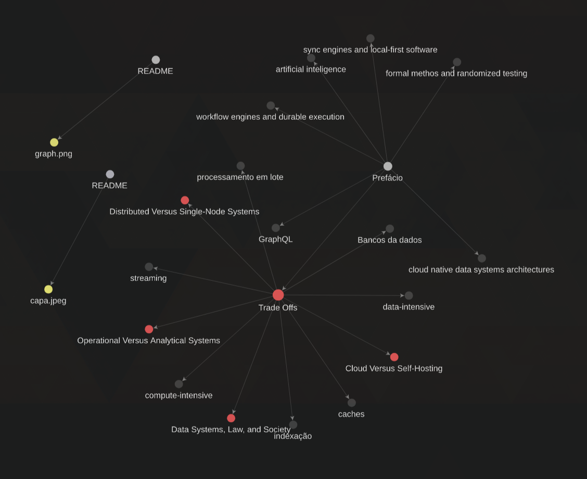

A ideia é escrever um resumo com as minhas próprias palavras, destacando os pontos mais importantes e conceitos-chave abordados nos livros, documentações e artigos. O objetivo é consolidar o conhecimento adquirido e facilitar a revisão futura.

Dado o mundo que nos encontramos, onde os modelos de linguagem estão cada vez mais sendo utilizados, torna-se vital gerar uma base de conhecimento consistente e confiável.
Além disso, a prática de escrever resumos ajuda a desenvolver habilidades de síntese e comunicação, permitindo que eu compartilhe informações de forma clara e concisa com outras pessoas.

## Abrir no Obsidian

Este repositório contém notas em Markdown e foi organizado para ser usado com o Obsidian.

1. Clone o repositório.
2. No Obsidian, escolha **Abrir pasta como vault** e selecione a pasta raiz `axioms`.
3. Use o ícone de grafo na barra lateral ou a paleta de comandos para abrir a visualização do grafo.

A pasta `.obsidian` inclui preferências e a configuração dos plugins centrais, incluindo o grafo. Não é necessário instalar plugins comunitários para abrir as notas. Os arquivos continuam sendo Markdown e também podem ser lidos em outros editores.

## Grafo de notas

O Obsidian monta o grafo a partir dos links entre as notas, como `[[nome da nota]]`. O arquivo `.obsidian/graph.json` guarda as preferências visuais e os grupos de cor. Atualmente, as notas em `books/design-data-intensive-applications/Chapter.1` recebem a mesma cor, identificando-as como parte do capítulo 1. Esse grupo altera a cor dos nós, mas não fixa sua posição nem cria uma região separada no grafo.
