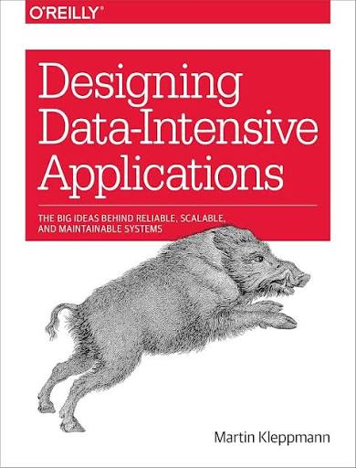

# Designing Data-Intensive Applications (Edição 2)

---
As anotações serão dividas entre os capítulos do livro utilizando pastas. Ainda não sei como será a organização final pois irei ajustando conforme for avançando na leitura. A ideia é que cada capítulo tenha uma pasta com os arquivos de anotações, resumos e exemplos de código.

Alguns conceitos posso acabar incrementando por conta de experiências próprias ou mesmo por já ter lido a edição 1.
O livro só tem a versão em inglês, ainda não sei se irei traduzir todos os resumos.

